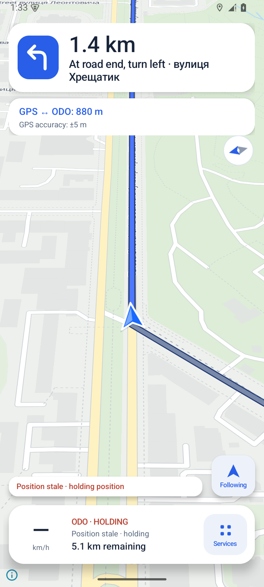
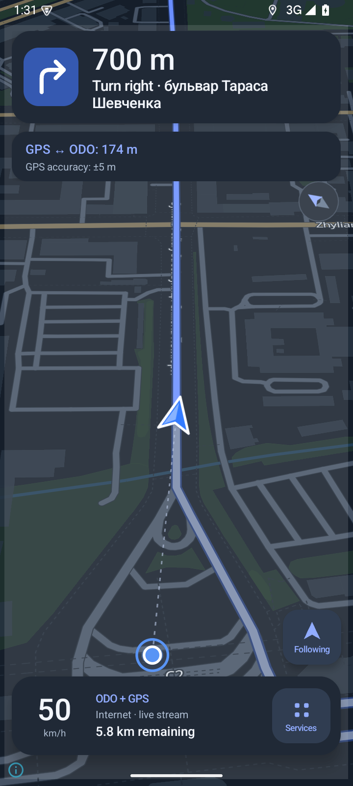
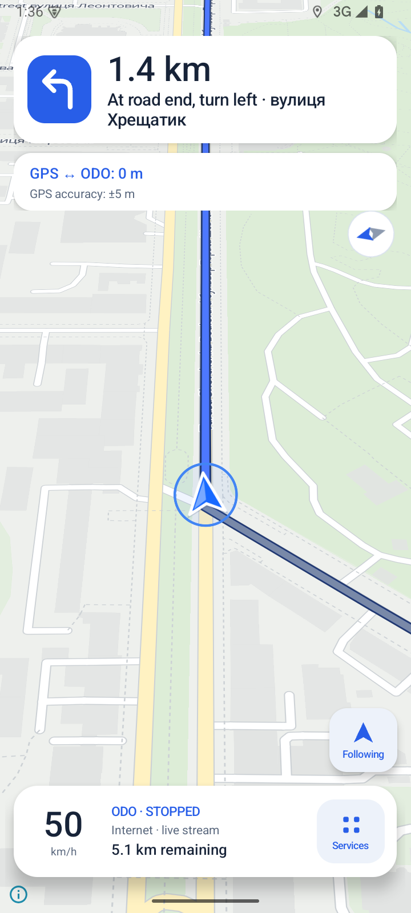

# RouteOdo 0.4.0 verification

Verified 11 September 2026 on an isolated Android 15 / API 35 ARM64 emulator. Test coordinates and the existing mock odometer were used; no real BMW drive is represented by these captures.

## Build

- `:app:testDebugUnitTest`: **47 passed**, zero failures/errors/skips.
- `:app:assembleDebug`: passed; Android 8.0+ APK, application ID `dev.routeodo`, version code 4.
- `:app:lintDebug`: passed, **0 errors / 34 warnings** (including compatibility/deprecation and framework UI warnings).
- APK Signature Scheme v2 verified. Signing certificate matches the previous APK, and an in-place installation succeeded.
- APK SHA-256: `bbda8e791ca77d8320c3eb68620e25a5564f53330aa3fd756f4318a7259d5539`.

Gradle 8.13 ran against an identical temporary source copy because the Documents workspace uses on-demand file hydration. The host's older JetBrains Java 17 runtime crashed in the JIT compilation of a lint analysis method. The successful validation run excluded that host-only method from JIT compilation:

```sh
gradle :app:testDebugUnitTest :app:assembleDebug :app:lintDebug \
  --max-workers=1 \
  '-Dorg.gradle.jvmargs=-Xmx2048m -Dfile.encoding=UTF-8 -XX:CompileCommand=exclude,org.jetbrains.uast.kotlin.FirKotlinUastResolveProviderService::getArgumentForParameter'
```

No workaround changes application behavior or suppresses lint checks.

## UI and storage checks

| Check | Observed result |
| --- | --- |
| Upgrade / offline compatibility | Installed 0.3.0, downloaded its 12 MB route pack, disabled both networks, upgraded in place; both bundled styles render existing streets and labels. |
| New map download | 0.4.0 downloaded the Kyiv-area pack successfully; Ready offline, 33 MB. Route/Kyiv download, pause, refresh/remove and online refresh controls remain reachable. |
| Independent positions | Raw GPS stays off-route; separation changed as the calculated point moved. Controlled 83.4 m separation and ±22 m accuracy were displayed. |
| Overlap | At the same coordinate, GPS retains its blue ring under the directional chevron; neither source replaces the other. |
| Stale GPS | After a fix expired, the live GPS dot/accuracy layers disappeared and GPS stale was displayed. |
| Show both | Both positions and the accuracy circle fit clear of the driving cards. |
| Follow | Automatic transitions retain Following. Map drag releases follow; Recenter restores calculated-position following. Portrait and landscape layouts were inspected. |
| Services | Back to map clears the system status bar. Existing controls are inventoried in DRIVING_UI.md; Preview seeking, +100 m and Drive, API setup, Start/Stop route, appearance and map menus were exercised. |
| API-driven display | Existing mock SSE feed drives 50 km/h ODO + GPS navigation, changing maneuver distance and separation while Following stays active. It is visually distinct from purple-labeled Preview. |
| Appearance persistence | Selected Day, allowed it to apply, cold-restarted without networking; Day and the saved map remain available. |
| Credentials / engine | No new application logging; no token entered into the test configuration. CarFeed, TripTracker, Route, GPS Sync, codecs, token/trip stores and route planner are unchanged. |

Full Kyiv download completed before the pause test, so this run verifies its completion and control reachability rather than claiming an interrupted transfer. Real GPS hardware, Pi LAN/mobile routing, and BMW driving still require testing on the user's device.

## Captures

Maps contain data from [OpenStreetMap contributors](https://www.openstreetmap.org/copyright), [OpenMapTiles](https://openmaptiles.org/), and [OpenFreeMap](https://openfreemap.org/). Coordinates and vehicle data shown here are emulator test inputs. Captures include intermediate UI validation builds with the same final visual design.

| Day, cold launch offline | Night, mock API navigation | Overlapping sources |
| --- | --- | --- |
|  |  |  |

[Landscape](screenshots/landscape.png) · [Services](screenshots/services.png) · [Show both](screenshots/show-both.png) · [Kyiv download](screenshots/kyiv-download.png)
