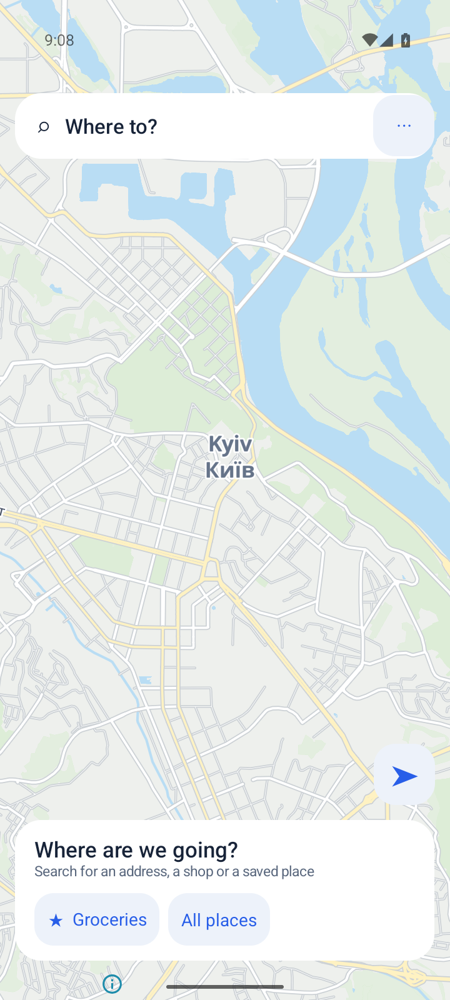
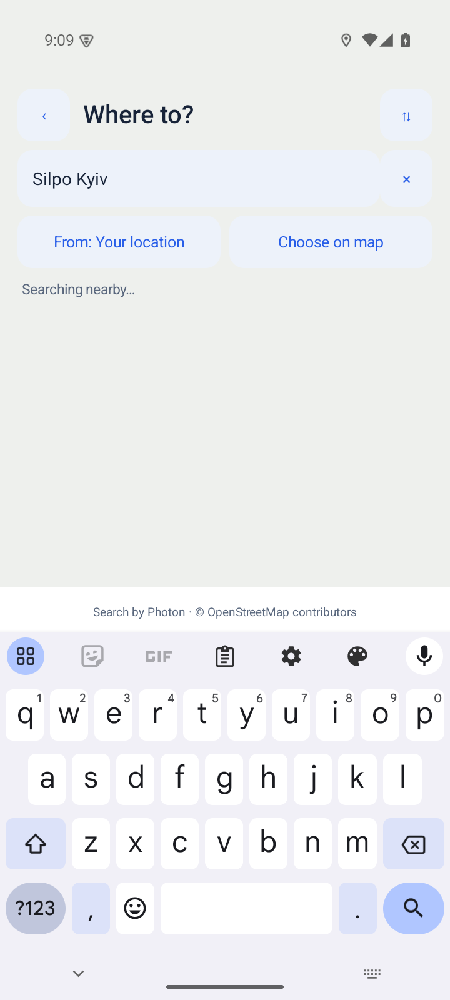
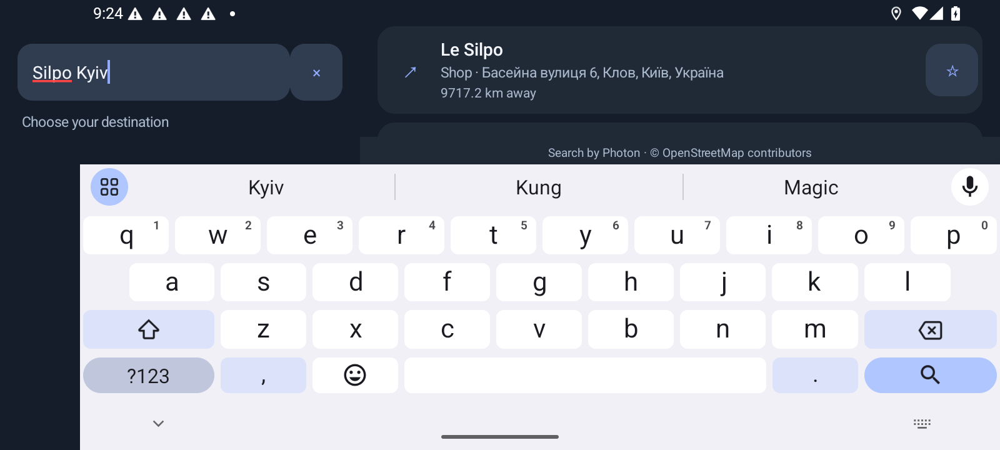

# Map-first UX verification — 15 October 2026

## Scope and build handoff

This update introduces destination-first live search, saved-place shortcuts, route preview, on-map Start/Stop, and an Advanced tools screen. The odometer engine and car transport are unchanged.

Voice-location and road-prediction work appeared concurrently in the shared checkout. It was preserved. To keep this task's results meaningful, tests used an isolated source copy of commit `86763388af78524cc4f622e82c0fa1fdf8f4e051` plus the UX changes. These results do **not** certify the combined unfinished changes. The agent preparing the final application should run checks on the integrated checkout.

Per the user's instruction, this task does not export or package a final APK. Existing temporary debug builds were used only for emulator testing.

## Automated results

- 57 unit/HTTP tests passed; zero failures or errors.
- Android lint: zero errors, 25 warnings (primarily existing platform/deprecation/style warnings).
- Test-build compilation succeeded.
- `git diff --check` passed.

New tests cover typing debounce, request pacing, cancellation races, stale-response rejection, clearing/closing search, invalid service configuration, business categories, 15-result query limits, credential separation, cache reuse, journey phases, and route-preview metadata persistence. Existing odometer, GPS rollback, epoch, calibration, route geometry, and car-transport tests also pass.

The local tools cache had cloud-offloaded files. Validation therefore used `/private/tmp/routeodo-ux-build`, `/private/tmp/routeodo-ux-sdk`, `/private/tmp/routeodo-ux-runtime/gradle-8.13`, and `/private/tmp/routeodo-ux-gradle-home`. JBR 17.0.9 needs this workaround for an AArch64 compiler crash in Kotlin lint, unrelated to Android application execution:

```sh
JAVA_HOME=/Applications/PyCharm.app/Contents/jbr/Contents/Home \
GRADLE_USER_HOME=/private/tmp/routeodo-ux-gradle-home \
/private/tmp/routeodo-ux-runtime/gradle-8.13/bin/gradle \
  --offline --no-daemon --max-workers=2 \
  '-Dorg.gradle.jvmargs=-Xmx2048m -Dfile.encoding=UTF-8 -XX:CompileCommand=exclude,org.jetbrains.uast.kotlin.FirKotlinUastResolveProviderService::*' \
  -p /private/tmp/routeodo-ux-build testDebugUnitTest lintDebug
```

The final successful check log is `/private/tmp/routeodo-ux-final-build.log`; JUnit and lint reports are under the isolated copy's `app/build` directory. The isolated MainActivity contains only this task's UI integration; the shared MainActivity also contains the other tasks' changes.

## Observed emulator checks

Android 15, arm64, 720 × 1600 at 280 dpi:

- Fresh launch opens Kyiv browsing without starting the demo or a simulated drive.
- Real Photon search for `Silpo Kyiv` returns named supermarkets and their Kyiv addresses. A direct Ukrainian `Сільпо` request returned 15 results.
- Saving Le Silpo as `Groceries` adds a shortcut; the place survives restart and an in-place app update.
- With GPS denied, selecting Le Silpo followed by `Kyiv railway station` produces a real OSRM route: approximately 2.7 km / 5 min. Preview displays destination, origin, distance, and estimate with Start/Edit controls.
- On-map Start opens first-use connection setup. Connect & start against the repository's unauthenticated local mock creates a running local odometer session. Confirmed movement exceeded 97 m and the map showed 35 km/h with updated route progress.
- On-map Stop leaves `running=false`, `live=false`, `routeSelected=false` and returns to browsing/saved shortcuts.
- Fresh available GPS automatically supplies the origin; changing the origin remains available.
- Rapid typing initially exposed an EditText input-connection reset. Updating enabled state only when it actually changes fixed this; the complete `Silpo Kyiv` query is retained while results update.
- Keyboard-visible portrait search hides the unneeded origin field and incomplete Preview button. Final map styling no longer produces the rectangular emulator shadow artifact.
- Menu access and night-mode landscape browsing were visually verified.
- Landscape testing exposed a large-keyboard layout problem. Search now switches to side-by-side input and results when vertical space is constrained. The final emulator check confirmed the full query and a complete named-place suggestion remain visible above the large keyboard, with attribution in the results pane. Dismissing the keyboard restores the full layout without losing the query or results.





## Limits

These are UX test results with a local mock, not a real BMW driving test. Photon/OSM place coverage differs from Google's catalogue. This iteration does not revalidate physical GPS hardware, the Pi LAN/public fallback on a real network, or a complete offline pack download; their implementations remain unchanged.

The Google APIs emulator initially encountered widespread input ANRs, including the launcher, under heavy background-service/CPU contention. The RouteOdo kernel stack sampled during one timeout was idle in `do_epoll_wait`; this alone does not prove every timeout was external. Checks were repeated after restarting the disposable emulator with four virtual cores, 2 GB RAM, and unrelated Google background services disabled. UIAutomator could not consistently reach an idle state, so screenshots and observed control coordinates were used for visual checks.

## Final integrated verification

After all three sessions completed, the final shared source was copied into `/private/tmp/routeodo-combined-build` and checked with `:app:testDebugUnitTest :app:assembleDebug :app:lintDebug`. The build passed: 73 tests, zero failures/errors, and lint with zero errors and 34 warnings. The build copy was verified byte-for-byte against `app/src` in the shared checkout. This includes the final keyboard fixes, voice-location prototype, and experimental road prediction.

The installable combined debug build is `dist/RouteOdo-0.5.0-debug.apk`, with a SHA-256 sidecar. APKs and copied build reports remain local under ignored `dist/`. The integrated check covers compilation, unit/HTTP tests, and lint; live voice, sensors, and real driving remain unverified.
